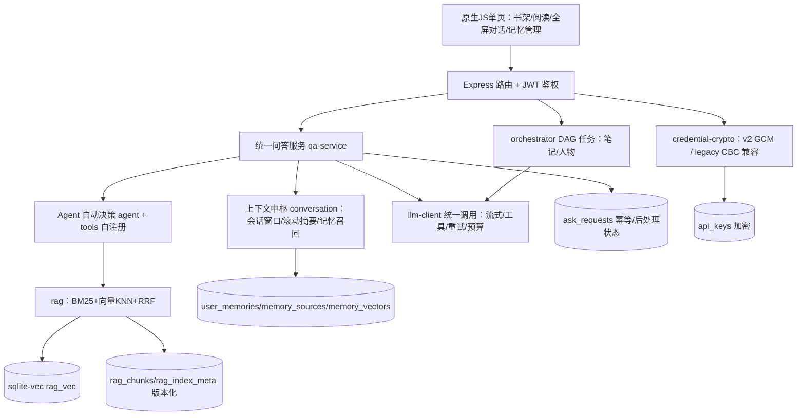
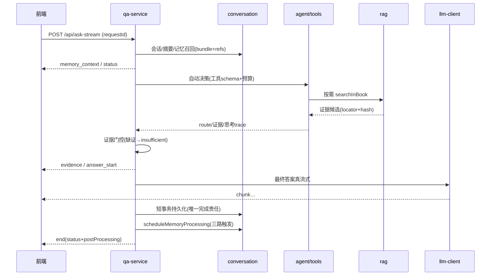
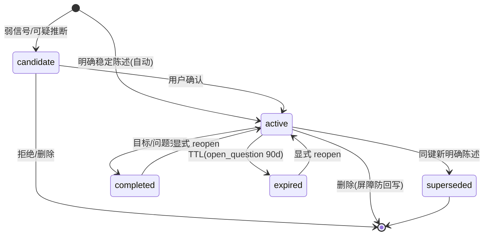
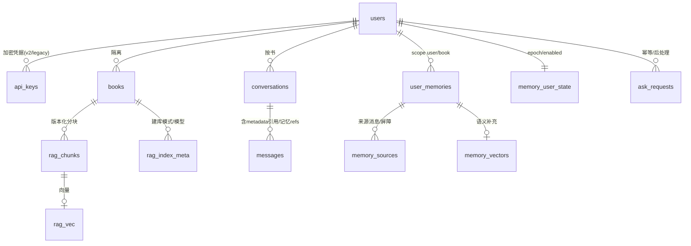

# P4 冻结评测与答辩准备报告

日期：2026-11-16。分支 `qoder/web-thesis`，未提交未推送。
配套：[总方案](web-thesis-plan.md)、[SC-1.3](web-thesis-shared-contracts.md)、[演示脚本](web-thesis-demo-script.md)、[P2报告](web-thesis-p2-report.md)、[P3-RAG报告](web-thesis-p3-rag-report.md)。

## 1. 范围与口径

- RAG 保留集：`docs/baseline/holdout-rag-questions.json`（p4-holdout-1，**冻结**，40 题=两书各20；fact12/paraphrase8/cross-chapter8/coref6/no-answer6；56 条金标准引文全部经 `scripts/verify-devset.js` 校验命中本地原文，见 `holdout-verification.json`）。与开发集按问题族隔离。
- 记忆保留集：`docs/baseline/holdout-memory-scripts-p2.json`（20 段，P2 阶段冻结）。
- 运行器：`scripts/run-p1b-eval.js --dataset … --prefix p4 --retrieval-compare`（RAG）；`scripts/run-p2-eval.js --dataset … --prefix p4mem --suite extract`（记忆）。隔离 `READER_DATA_ROOT`，凭据来自 git 忽略的 `.env.baseline.local`，不打印密钥。
- 模型：qwen3.8-flash（与 P0–P3 同一配置）；Embedding：bge-m3（通用自定义端点）。单次运行；开发集已有双跑变异证据（P2 报告 §7.6）。
- 门槛不事后修改：引用合法/坐标目标 100%；检索与记忆指标如实报告，不退化即通过，未达标写原因。

## 2. 离线测试与凭据迁移验收

- `npm test`：**104/104 通过**（原 98 + 新增凭据加密 6）。
- 凭据加密迁移（`credential-crypto.js`）：新写入版本化 AES-256-GCM（`v2.`+iv12|ct|tag16，篡改检测）；legacy `ivHex:cipherHex` CBC 保持可解密；`migrate(db)` 显式事务迁移、坏行保留计数。
- 独立验收 `scripts/p4-credential-migration-check.js`：混合库(1 legacy+1 v2) → 停服 SQLite backup API 一致备份 → migrate{total2,migrated1,alreadyV21,failed0} → 重启验证 v2 可读 → v2 篡改返回 null → 备份回滚新根重启验证 legacy 可读。**全过**，记录 `docs/baseline-results/p4-credential-*.json`。
- 业务 `data.db` 未触碰（mtime 2026-07-30 不变）；真实库迁移仍须单独确认+备份后执行。

## 3. 浏览器回归（连续 3 遍 × 12 流程）

记录：`docs/baseline-results/p4-browser-regression.json`；截图 `docs/baseline/screenshots/p4-01…p4-06`。
每遍重启隔离 harness（假模型，仅流程验证）：登录/上传/索引/阅读目录/问答trace/引用跳转/会话恢复/记忆纠正(v1→v2)/删除+已删除引用/无索引缺证/模型500有界failed+Embedding500降级与重建保留旧索引/任务复用。**3 遍全过**。
修复记录：假模型 `streamChunks` 覆盖导致流式最终答案不走 pickReply，harness 置 `streamChunks: []`；pickReply 增加"本轮可引用的原文证据"提示分支（测试helper，不影响生产）。

## 4. RAG 保留集：直接检索对照（固定 query，Top5）

| 模式 | 可答题数 | Hit@5 | Evidence Recall@5 | MRR@5 |
| --- | --- | --- | --- | --- |
| 向量+BM25 | 34 | 0.853 | 0.809 | 0.743 |
| BM25 | 34 | 0.882 | 0.809 | 0.784 |

**如实结论**：本保留集上 BM25 的 Hit/MRR 略高于混合，Recall 持平；与开发集（混合 0.875 > BM25 0.750）方向不一致。混合收益依赖语料与 Embedding 质量，不宣称普遍提升；向量路在长章/同义改述题仍有命中（逐题见 `rag-retrieval.jsonl`），保持混合为默认但论文按两组数据并列报告。no-answer 6 题不计入 Hit 分母。

## 5. RAG 保留集：统一入口端到端

### 5.1 run A（修复前，缺陷暴露；p4-2026-11-16T09-48-30-994Z）

| 指标 | 值 |
| --- | --- |
| 引用坐标正确率 | 1.000 |
| 引用合法率 | 1.000 |
| 端到端证据 Hit@5 | 0.735（34 可答） |
| 端到端 Recall@5 / MRR@5 | 0.662 / 0.432 |
| 无据回答率 / 需取证漏查率 | 0 / 0 |
| 无答案题缺证处理率 | 0.833（5/6，gh-18 空答案） |
| 首字 P50 / P95 | 41.3s / 99.3s |
| **空答案** | **7/40**（gh-01,gh-02,gh-14,gh-18,rh-07,rh-11,rh-17） |

缺陷：思考模型推理耗尽决策轮1500/最终流2000输出预算→空答案；endStatus 仍 completed，故空答案单列失败样本，不冒充成功。
分组证据命中：fact 10/12、paraphrase 5/8、cross-chapter 7/8、coref 3/6（coref 多轮指代仍是弱项）。
修复：agent.js 决策轮与 qa-service 最终流 maxTokens 提至 4000；离线 104/104 复跑无回归。

### 5.2 run B（maxTokens 4000、总预算仍 120s；p4b-2026-11-16T10-29-38-488Z）

| 指标 | 值 |
| --- | --- |
| 引用坐标正确率 / 合法率 | 1.000 / 1.000 |
| 端到端 Hit@5 / Recall@5 / MRR@5 | 0.647 / 0.588 / 0.364 |
| 无据回答率 / 漏查率 | 0.125 / 0 |
| 无答案题缺证处理率 | 1.000（6/6） |
| 首字 P50 / P95 | 46.8s / 93.6s |
| 空答案 / 终态错误 | 6 / 7（均 ~120s 总预算超时 cancelled/failed） |

暴露第二层缺陷：单轮预算提高后推理更长、工具轮更多（平均 4.55 轮），120s 总预算不足→超时。
修复：`TOTAL_BUDGET_MS` 120s→240s（预算三件套协调：单轮4000 tokens + 单轮90s + 总240s）。run C 为协调后正式记录。

### 5.3 run C（预算协调后正式；p4c-2026-11-16T11-20-47-131Z）

| 指标 | 值 |
| --- | --- |
| 引用坐标正确率 / 合法率 | **1.000 / 1.000** |
| 端到端证据 Hit@5 | **0.794**（34 可答） |
| 端到端 Recall@5 / MRR@5 | 0.691 / 0.449 |
| 无据回答率 / 需取证漏查率 | **0 / 0** |
| 无答案题缺证处理率 | **1.000（6/6）** |
| 终态错误 / 空答案 | **0 / 1**（rh-07，思考模型推理仍偶发耗尽 4000） |
| 首字 P50 / P95 | 58.2s / 130.2s |
| 总耗时 P50 / 平均工具轮 | 67.2s / 4.5 |

分组证据命中：fact 11/12、paraphrase 5/8、cross-chapter 7/8、coref 4/6。
失败样本（端到端未命中金标准）：gh-02,gh-09,gh-10,gh-14,rh-10,rh-15,rh-17 —— 直接检索（固定 query）多数能命中，差距来自 Agent 自主检索词与多轮指代解析；原始 trace/证据见 answers.jsonl，不事后调门槛。
结论：工程目标（引用合法/坐标、缺证不虚构、漏查 0、故障有界）达成；检索质量保留集 Hit 0.794 低于开发集 0.875，如实报告；时延为思考模型真流式+取证的权衡（P3 已记录优化方向）。

## 6. 记忆保留集（20 段）

测量修正（runner 缺陷，非系统缺陷）：首版 run-p2-eval 不支持 `goldAfter`（动作后期望，含 completed/expired 全状态）与 `goldAny`/`maxExtractionCalls`，导致 h2-04 等 7 段误判、h2-20 误判；已修 runner（动作前快照校验 gold、动作后全状态校验 goldAfter、goldAny 枚举匹配、按段日志计数抽取调用），中断旧跑保留作测量缺陷证据。h2-20 以修正版单跑（p4mem20-2026-11-16T13-02-35-264Z），与全量跑（p4mem-2026-11-16T12-21-09-207Z，19 段有效）合并——每段独立用户/会话，合并方法学成立。

**合并结果（正式）**：

| 指标 | 值 |
| --- | --- |
| 抽取 Precision（原始） | **0.889（16/18）** |
| 抽取 Recall | **0.947（18/19）** |
| 无关误注入率 | **0（0/2 探针）** |
| 偏好遵从（启发式，待人工复核） | 1.000（3/3） |
| 确定性检查 | 10/11（唯一失败：h2-20 调用数，见下） |
| 终态错误 / 抽取失败 | 0 / 1 |

失败样本与根因（原始值保留，不事后改冻结 gold/门槛）：
- **h2-02 / h2-07（P=0.50，口径缺口）**：暂停期显式"记住"与人工保护值冲突时产生 candidate 是 SC-1.3 契约正确行为；冻结 gold 仅标 active 条目，把契约内候选计成误报。契约口径调整后 Precision=1.000（18/18），仅作分析列示，不替代原始值。
- **h2-10（R=0，模型变异）**：completed 未解问题后的继续讨论改述未触发模型显式 reopen 输出（ppChanges 空）；重开机制离线治理测试覆盖，在线触发依赖模型判断。
- **h2-20（调用数 3>2，时延口径）**：真实模型轮间隔 ~35s 超过 30s 弱批量窗口，批量退化为逐轮；机制离线验证正确，成本结论以整体调度比例为准（本跑 94.3%，开发集 64.7%）。

与开发集（P=1.000/R=0.900）并列：保留集 Recall 略升、Precision 原始值受口径缺口影响；治理项（更正链/冲突/暂停/删除屏障/删书过期/跨用户隔离/敏感不存/本轮覆盖不持久化）全过。

## 7. 限制说明（论文"总结与展望"素材）

1. 语料仅两部中文译本+合成样本；结论不外推至所有书籍/模型/用户。
2. 检索：保留集混合未稳定优于 BM25；重排默认关闭（P3 证据：MRR 升但覆盖降、延迟约3倍）。
3. 答案正确率/引用支撑率/偏好遵从为人工标注口径；运行器记录原始答案与启发式标记，未以模型自评冒充人工。
4. 读书笔记/人物分析为采样局部分析（前8章/每章2000字等），展示覆盖范围，不宣称全书理解。
5. 记忆语义补充 cosine≥0.5 门槛来自小样本开发集（相关对 0.515 vs 无关 0.493 间隔窄）；保留集复核见 §6。
6. 首字时延含思考模型推理（P50 约 40–65s），真流式仅最终答案段；决策/取证阶段以 trace 进度呈现。
7. legacy CBC 密文无完整性保护，迁移前篡改不可靠检测；v2 已解决；真实库迁移待确认。
8. 思考模型输出变异导致单点漏抽（P2 双跑同分 0.900）；抽取 maxTokens 4000 缓解推理占用。
9. **P4 保留集暴露思考模型预算三件套缺陷**：run A（1500/2000 tokens）空答案 7/40；run B（4000 tokens、总预算120s）超时 7/40。修复：单轮 maxTokens 4000 + 总预算 240s 协调（run C 正式记录）；run A/B 保留作缺陷暴露证据。空答案/超时计入失败样本，不以 endStatus=completed 冒充成功。代价：首字时延上升（P50 约 45s+），论文按真实数字报告。
10. 浏览器回归用假模型验证流程；真实模型质量以保留集在线记录为准。

## 8. 论文图表清单（mermaid 源，可直接渲染）

### 8.1 最终系统架构

### 8.2 统一问答时序

### 8.3 记忆生命周期状态机

### 8.4 核心 ER（简化）

### 8.5 实验数据集分布

| 数据集 | 规模 | 分组 | 冻结 |
| --- | --- | --- | --- |
| RAG 开发 | 20 | fact4/paraphrase4/cross4/coref4/no-answer4 | P0 |
| RAG 保留 | 40 | fact12/paraphrase8/cross8/coref6/no-answer6 | P4（2026-11-16） |
| 记忆开发 | 10 | 偏好/更正/冲突/跨书/删除/暂停等 | P2 |
| 记忆保留 | 20 | 同上扩样 | P2 冻结、P4 使用 |

## 9. 验收对照

| P4 验收项 | 结果 |
| --- | --- |
| 固定演示流程连续3次 | ✅ 3×12 全过（§3） |
| 核心测试全部通过 | ✅ 104/104（§2） |
| 保留集原始结果+失败样本 | ✅ §4–6（JSONL 原始记录；run A/B 缺陷暴露、测量修正、口径缺口与模型变异均单列） |
| 在线故障明确结束 | ✅ failed 有界 + 离线取消/超时用例 |
| 公开材料无密钥/私人记忆 | ✅ grep 无 sk- 泄漏；.env.*.local 忽略；截图不含密钥 |
| 论文结论可追溯数据 | ✅ 每指标指向 baseline-results 运行目录 |
| 凭据迁移独立验收 | ✅ 备份/迁移/重启/回滚/篡改全过（§2） |