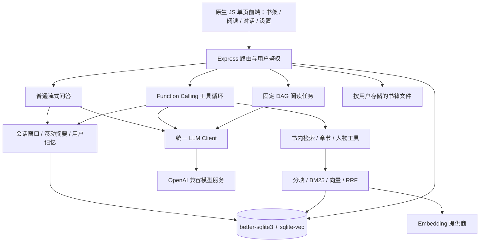
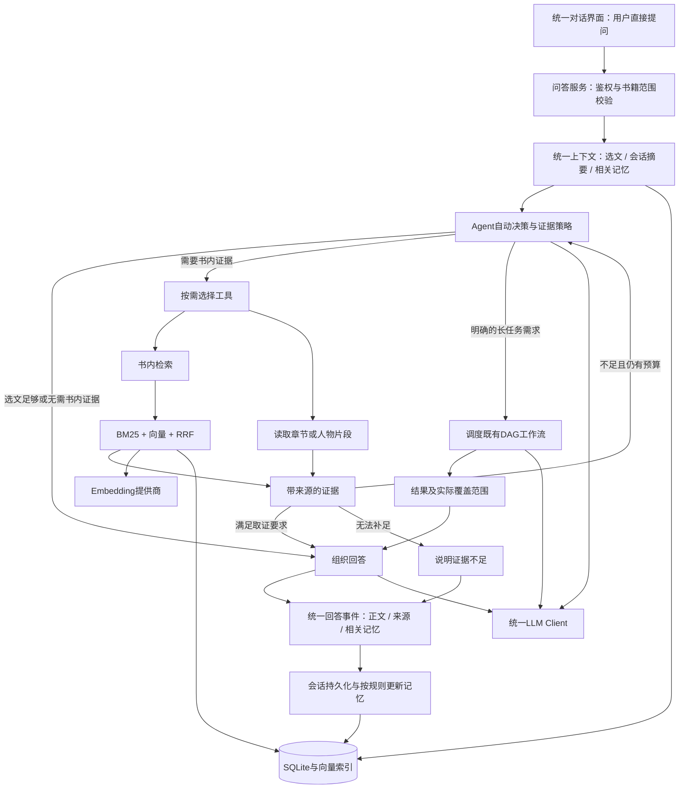

# Web 毕设改造：现状评估与分阶段方案

日期：2026-10-28（2026-11-16 更新进度）。状态：P0/P1a/P1b/P2/P3（RAG+记忆）/P4 已完成并验收；用户授权的「自定义向量+重排」增强已实现。详见下方「进度更新」。

题目：**基于Agent与RAG的智能阅读系统的设计与实现**。

近期里程碑：2026-11-07开题答辩；其他论文和系统里程碑在2027年，具体日期待学校安排。不要求开题前完成所有改造。P0详见 [web-thesis-p0-plan.md](web-thesis-p0-plan.md)。

交接与实施阅读顺序：本总方案 → [共享接口与协作约定SC-1.3](web-thesis-shared-contracts.md) → 对应阶段实施方案 → 当前代码与阶段报告。共享约定定义模块间目标接口，不代表已实现。

模块实施方案已细化：[RAG（P1b＋P3-RAG）](web-thesis-rag-plan.md)、[记忆（P2＋P3-记忆）](web-thesis-memory-plan.md)，均包含结构/迁移、算法流程、API/UI、子任务和测试。P1a的具体实施方案仍需在其阶段开始前制定；不要绕过统一问答前置直接让两个AI并行改共享文件。

## 进度更新（2026-11-16）

| 阶段 | 状态 | 关键结果 | 报告 |
| --- | --- | --- | --- |
| **P0 基线与演示底线** | ✅ 完成 | 工程关卡 P0-01~10 全通过；离线测试通过；浏览器主流程冒烟通过；20题RAG+10段记忆开发集（金标准全部命中原文）；在线开发集初测（qwen3.8-flash）：BM25 Hit@5=0.750，agent漏查率11.7%，记忆漏抽 | [P0报告](web-thesis-p0-report.md) |
| **增强：自定义向量+重排** | ✅ 完成（用户授权，超出P0原边界） | 通用自定义Embedding端点（bge-m3）+可选重排（bge-reranker-v2-m3，默认关闭）；消融：混合较BM25提升Hit/Recall，重排提升MRR但牺牲覆盖且延迟约3倍→保持默认关闭 | [增强报告](web-thesis-embedding-rerank-report.md) |
| **P1a 统一问答与自动取证** | ✅ 完成 | 单入口/api/ask-stream（移除Agent开关与旧agent/stream）；requestId幂等；唯一完成责任（先持久化后end）；证据门控；真流式+取消/预算；离线52/52（含9项验收）；真实模型对照：漏查率11.7%→0%、无据回答率0%、首字P50 17.7s→34.6s（真流式+取证的权衡，P3优化） | [P1a报告](web-thesis-p1a-report.md) |
| **P1b 可核验引用闭环** | ✅ 完成 | locator/规范文本/版本化索引/引用跳转/证据快照/建库互斥；离线76/76；浏览器21场景；开发集引用坐标正确率100%、引用合法率100%、端到端Hit@5=0.875、首字P50 22.2s | [P1b报告](web-thesis-p1b-report.md) |
| **P2 记忆治理闭环** | ✅ 完成 | web_003 迁移/来源约束/作用域/冲突/确认/删除屏障/暂停；离线98/98；浏览器16+3场景；开发集抽取 Precision=1.000、Recall=0.900（两次运行同分、单点漏抽为模型变异）、无关误注入0、触发调度64.7%（旧每轮1次） | [P2报告](web-thesis-p2-report.md) |
| **P3 个性化与检索增量** | ✅ 完成 | P3-RAG：分块1200采纳/扩展与重排评估后不设为默认/缓存无瓶颈。P3-记忆：词法门槛冻结0.25；语义补充采纳（记忆独立向量 web_004，cosine≥0.5，开发集相关召回1/3→3/3、误注入0，降级词法）；分层注入对照符合设计、不以条数论效果 | [P3-RAG报告](web-thesis-p3-rag-report.md)、[P2报告§7-8](web-thesis-p2-report.md) |
| **P4 冻结评测与答辩** | ✅ 完成 | RAG保留集40题冻结校验全命中；run C：引用合法/坐标100%、漏查0、缺证6/6、0终态错误、Hit@5 0.794（如实低于开发集）；记忆保留集20段 P=0.889/R=0.947、误注入0（口径缺口与模型变异失败样本在案）；浏览器3遍×12流程；凭据v2-GCM迁移独立验收全过；离线104/104；暴露并修复思考模型预算三件套缺陷 | [P4报告](web-thesis-p4-report.md)、[演示脚本](web-thesis-demo-script.md) |

说明：
- 已完成阶段均遵守边界：分支 `qoder/web-thesis`，无 mobile/ 改动，受保护数据（data.db/books/rag_index/.env）完整，密钥存于被 git 忽略的 `.env.baseline.local`、不入库不打印，未提交未推送。
- P1b 已交付 locator/规范文本/引用跳转：新 book_excerpt 均 verified 可跳转，旧索引标需重建；记忆治理仍为 P0 水平，作用域/冲突/来源属 P2。
- 测试与原始记录位于 `docs/baseline/`、`docs/baseline-results/`（online/ablation/p1a/p1b/p3/fake，均标注口径；fake 仅流程验证非成绩）。
- P1b、P3-RAG、P2、P3-记忆、P4 均按用户逐阶段确认完成（P2/P3-记忆/P4 确认于 2026-11-16）；全部阶段已交付，真实业务库迁移仍须单独确认。

## 0. 结论与边界

建议保留现有技术栈，以“**有原文依据、能延续理解、允许用户纠正的个性化阅读助手**”为主线，而不是继续增加 Agent 数量。

- RAG 回答“书里到底怎么说”，重点做检索质量、可核验引用、失败时不冒充有据可依。
- 记忆回答“这个用户需要怎样的帮助”，重点做证据来源、更新冲突、相关性和用户控制。
- Agent 负责按需检索、补充上下文和组织回答；不把工具数量、多 Agent 数量当贡献。
- “越来越懂你”应落实为跨会话偏好遵从、阅读目标延续、旧偏好纠正等可观察行为，不等于训练或更新模型参数。
- 额外值得写的侧重点是**可信交互与可观测评估**：展示回答依据、此次使用的用户记忆和失败原因。这比新增知识图谱或框架迁移更贴近工程产品型本科论文。

工作边界：

1. 只在 `qoder/web-thesis` 开展 Web 毕设工作，不切换或修改 `qoder/android-app`，不读取或修改 `mobile/` 内容。
2. 核心业务改造范围为 `server.js`、`rag.js`、`agent.js`、`conversation.js`、`orchestrator.js`、`llm-client.js`、`database.js`、`public/`。
3. 用户已允许必要Web支持文件的最小扩展，包括工具实现、文本定位辅助、Embedding适配、测试脚本及必要npm脚本；阶段方案须列明文件和理由。允许支持文件不等于允许随意重构或新增外部依赖。
4. 不删除 `data.db`、`books/`、`.env`、`rag_index/`，不提交密钥或运行数据。未来迁移须先说明、备份、在隔离数据库验证，不通过删库重建解决问题。
5. 所有计划、架构说明、测试报告、论文图表和演示素材放在 `docs/`。本轮检查记录见 [web-thesis-baseline-check.md](web-thesis-baseline-check.md)。
6. 每阶段开始前给出具体改动范围和验收用例，用户确认后实施；每阶段结束报告改动、验证、论文素材，不能一次确认就默认后续阶段全部开工。

## 1. 现状评估

### 1.1 当前实际架构

这是适合本科毕设的模块化单体，不需要改为微服务、React、LangGraph 或独立向量数据库。

| 层次 | 当前实现与可复用能力 | 证据 |
| --- | --- | --- |
| 产品前端 | 书架、TXT 阅读、目录、主题、划词问答、全屏对话、工具 trace、记忆列表、任务结果复用与导出 | `public/app.js:437-488,597-661,1094-1155,1243-1304,1377-1557` |
| 服务入口 | Express、用户隔离路由、模型提供商配置、SSE、书籍管理 | `server.js:36-51,578-732,843-976,1081-1264` |
| RAG | 章节/段落与滑窗分块；中文单字+双字；BM25、1024维向量、RRF；每路默认10、最终5；失败可降级 | `rag.js:24-137,199-269,278-352` |
| Agent | 工具自主选择及循环；现有三类工具；调用事件可展示 | `server.js:1106-1120`；`agent.js`；`tools/` |
| 会话与记忆 | 按书会话、近期窗口、滚动摘要、跨会话用户记忆；长期记忆已有查看/删除 UI | `conversation.js:187-391`；`database.js:112-153` |
| 阅读任务 | 读书笔记与人物分析任务，结果持久化，支持再次展示而非重复付费生成 | `server.js:1193-1253`；`orchestrator.js` |
| 存储 | better-sqlite3、sqlite-vec；RAG 块、向量和元信息已进 SQLite | `database.js:1-6,179-219` |

重要边界：支持上传 PDF/EPUB/MOBI，不等于支持其在线阅读和 RAG；当前完整阅读、索引、工具链只支持 TXT（`server.js:665-675,1036-1044`）。建议毕设 v1 如实限定 TXT。

### 1.2 对“已知可优化点”的核实

| 说法 | 核实结论 | 应如何处理 |
| --- | --- | --- |
| 向量 KNN 先全局再按书过滤 | SQL 已用 user+book 限定 rowid；内存微实验正确召回目标书 Top-10，未复现该问题 | 保留隔离回归，不以此为理由重构向量库；实验方法与限制见检查记录 |
| BM25 内存重建 | 部分成立：冷启动/缓存淘汰会从持久化块重建；已有按书 LRU，最多5本，不是每查询重建 | 先测冷/热耗时和多书缓存抖动，不急着换 FTS5 或中文分词依赖 |
| chunk 无 locator、引用不能跳转 | 成立；融合结果连块ID也未保留，前端只有目录滚动和 trace 摘要 | 高优先级补齐稳定定位与引用链 |
| 无改写、重排、父子块 | 当前检索链没有 | 它们是候选优化，不是必须全部补上的缺陷；只保留能证明有效的增量 |
| Agent 没有预检索且总结禁工具 | 当前入口先组装会话与记忆，随后由模型决定工具；提示词明确禁止总结等任务调用工具 | 按问题的证据需求路由，不是让所有问题强制检索，也不是给总结新增一次 LLM 工具 |
| 工具JSON截断、只有3个工具 | `agent.js:152-156` 对序列化结果硬切，当前阈值为6000字符；3个检索工具本身并非缺陷 | 裁剪结构后再序列化；只在阅读用例需要时增工具，不为数量扩展 |
| 每轮都抽取记忆 | 普通流成功完成、Agent有最终回答后会异步尝试；不等于每轮必写入 | 改为只处理新增用户信息，明确指令即时处理，普通候选按事件/批次处理 |
| 精确去重、无冲突/阈值 | 成立，详见 `conversation.js:293-386` | 作为记忆主线的核心问题 |
| 没有记忆分层 | 已有近期窗口、会话摘要、用户长期记忆；缺的是长期记忆内部的作用域、来源和生命周期 | 不从零重写“记忆系统”，补治理与个性化阅读状态 |
| 笔记仅前8章，每章前2000字 | 成立，`orchestrator.js:137-159`；大纲还只使用前20个标题及开头2500字符 | 不能当作全书理解结果；v1先显示采样范围，完整覆盖另立可选阶段 |
| 人物分析仅首次出现 | 编排先从前4000字符选最多5人，再各取首次出现附近片段，`orchestrator.js:239-272`；独立lookupCharacter工具则最多前6次，不要混淆 | 分析报告不能据此声称覆盖人物全书成长轨迹 |
| Key 前缀日志、AES-CBC | `server.js:793` 打印解密后Key前缀；`server.js:53-75` 未提供认证标签 | 作为安全底线分步处理；加密迁移必须保留已有凭据可用性 |

### 1.3 按毕业设计价值/成本排序

以下是投入优先级；安全底线无论论文亮点多少都必须满足。成本为相对评估，不是工期承诺。

| 顺序 | 问题与改造方向 | 毕设价值 | 成本 | 判断 |
| --- | --- | --- | --- | --- |
| 1 | 缺少可信实验基线，旧资料有估算成绩 | 极高：直接决定论文是否有证据 | 低—中 | 最先建立固定样本、指标与记录方式 |
| 2 | RAG 答案与原文之间缺少可验证引用 | 极高：现场能看见、可测、可画链路图 | 中 | 做成最先交付的阅读闭环 |
| 3 | 记忆无关注入、重复/矛盾并存、用户难纠错 | 极高：最贴合“越来越懂你” | 中 | 重点，不以“记得更多条”作为成功标准 |
| 4 | 总结一律禁工具、普通问答倾向依赖模型原著知识 | 高：证据可用性影响事实可信度 | 低—中 | 先纠正策略，再考虑更复杂自主规划 |
| 5 | 缺少完整请求预算、状态和故障可见性 | 高：防止演示卡住、失败被当成功 | 中 | 统一超时/取消/失败状态和结构化轨迹 |
| 6 | 日志泄露片段、模型返回字段校验不足、CBC无完整性保护 | 必做工程底线 | 低—中 | 日志与字段校验优先；加密格式迁移单独验收 |
| 7 | 索引重建先删旧版本；BM25等待向量路；降级标签可能失真 | 中—高：可靠性、延迟和观测准确性 | 中 | 优先建库互斥与可用版本发布，缓存是否升级看数据 |
| 8 | 多轮问题指代、局部块丢上下文、融合结果可能无关 | 中—高：可做检索消融实验 | 中 | 依次测按需改写、邻接/父块扩展，再决定重排 |
| 9 | Multi-Agent 长书覆盖与成本矛盾 | 中：任务展示强，但容易吞工期 | 中—高 | v1先诚实展示覆盖范围；完整全书分析放可选阶段 |
| 10 | 增加工具数、知识图谱、换框架、换前端、多格式解析 | 当前边际价值低 | 高 | 不纳入主线 |

补充的已确认工程风险：

- `rag.js:204-258` 重建时先删除当前块和元信息，向量化后才重新发布meta；期间检索可能无索引，重建并发/中断的影响需隔离复现。
- `rag.js:339-347` 先等待向量路再做BM25；当Embedding慢或失败时，本地检索会被外部服务拖延。
- `tools/search-in-book.js:30-33` 按建库mode标来源，而不是按本次实际参与召回的路径，降级后标签可能仍显示hybrid。
- `server.js:899` 有“不要拒绝回答”倾向；对书内事实问题应允许“现有证据不足”，不能把模型常识包装成原文依据。
- `conversation.js:355-362` 未限制模型输出的kind枚举，`public/app.js:1276-1281` 又直接把kind拼入HTML；应加入结构校验和安全渲染。这里只确认危险数据路径，未执行利用或完整安全测试。
- 普通回答结束后才检查压缩（`server.js:918-931`），不能替代发送前的完整上下文预算检查。
- `agent.js:99-111` 正常结束时直接发送非流式决策轮的完整答案；只有部分兜底分支另走流式。SSE事件不代表所有答案都逐token流式，性能评估应记录真正的答案首字。
- `llm-client.js:130-150` 没有刷新EOF尾缓冲或区分流正常结束和提前断开；配合上游关闭会出现怎样的部分结果，需用可控断流测试确认。
- `orchestrator.js:345-350` 调度结束就发task_done，不能据此认定每个子任务成功；UI与落库应区分完整成功、部分成功和失败。

## 2. 目标方案与分阶段计划

### 2.0 已确认的目标架构：统一问答与自动工具选择

用户已确认这一架构调整方向；以下是待实现的目标，不是当前代码状态。第1.1节保留原架构作为改造前对照。

**统一问答入口 + 自动工具选择 + 证据约束。** 用户直接表达阅读需求，不再先决定“普通问答还是Agent模式”。RAG是获取书内证据的能力，由系统按需调用，而不是另一个需要用户理解的开关。

图中的“满足取证要求”不代表算法能够证明语义正确：服务端可检查来源身份、范围、是否有证据等条件，引用是否真正支撑结论仍须按人工标注评测。

#### 职责和取舍

- **统一产品入口与业务服务。** 前端不再因Agent开关决定走哪个问答实现；会话、记忆、事件格式、结果保存和错误处理共用一套链路。长任务可以保留专用执行接口及书架快捷按钮，统一交互不意味着所有HTTP端点必须合成一个。
- **自动选择，不是每题强制检索。** 使用现有工具调用能力做按需决策，不默认给每个问题增加独立分类模型，也不只用一串关键词正则承担全部语义判断。
- **选文也是证据。** 解释/翻译已有选段，或回答选段直接包含的事实，可以不调用RAG；涉及选段之外的书内事实，需要检索或读取章节，不能仅凭模型对名著的印象回答。
- **取证要求可执行。** 结合明确的阅读操作、请求范围和模型决策确定取证需求，建立本轮证据记录；已判定必须取证却没有可用证据时，服务端安排受限补查、澄清或明确缺证，而非只写一句提示词。隐含需求识别仍可能出错，需要单独测漏查率。
- **证据类型不混用。** 用户记忆影响表达方式和阅读目标，不替代书籍事实；普通知识回答明确区分于本地原文依据。
- **长任务不伪装成Top-K问答。** 自动识别后复用DAG任务入口，显示执行进度与已处理范围；缓存可复用。意图不明确时先澄清，不把随口问一句自动扩张成整书重算。P1a只接入现有任务，不宣称已有全书覆盖能力。
- **降级仍遵守取证规则。** 模型不支持工具调用时，对明确的书内问题可由服务端先取证后调用模型；不能把缺工具能力等同于允许无依据作答。没有索引时告知真实状态，不偷偷建立整书向量索引。
- **真流式和有界执行。** 明确可直答的场景保留逐步输出；自动工具路径在决策/取证时展示进度，最终回答流式输出。工具参数必须接收完整并验证后才能执行，不把不完整JSON执行或展示成答案；不能用一个完整答案chunk冒充逐token流式，也不能先发无据结论再事后补来源。
- **控制架构成本。** 保留Express、SQLite、现有工具注册和DAG，不为统一入口引入新Agent框架。优先修改既有模块；若确需提取共享问答服务，在P1a详细方案列明理由。

### 2.1 主线一：证据可追溯的 RAG

推荐流水线：

> 问题与当前书籍 → 必要时解析指代 → 限定用户/书籍检索 → BM25+向量+RRF → 去除重叠、按需补相邻上下文 → 证据列表 → 回答与合法引用ID → 点击回到原文。

具体取舍：

1. **先做好定位。** 每个块保留bookId、稳定章节/段落标识、start/end、内容版本或hash；偏移统一针对后端解码后的文本，明确UTF-16码元与换行规范，不能把数据库字节偏移直接当DOM位置。前端目前会trim并合并空行，要建立原文到渲染节点的映射。
2. **服务器管理引用。** 回答只能引用本轮实际提供的证据ID；返回结构化证据元数据，引用ID和元数据随答案持久化，重开会话仍可跳转。重建索引或更换内容后先校验版本，失效时提示而非误跳。
3. **区分两个正确性。** 引用ID存在不等于它真的支持结论；前者可自动校验，后者需要答案级人工标注。
4. **先复用BM25和RRF。** 冷/热耗时没有证据前，不为了“持久化”换掉已有缓存；中文FTS5还要解决分词适配，不能当作无成本替代。
5. **按需优化。** “他后来怎样了”这种问题先用近期会话解析实体；明确的事实问题直接检索。对命中块扩展同段/相邻块比立即建立多层摘要库更小、更可控。
6. **重排是选修。** 仅在标注集显示融合误排，且现有提供商能稳定复用时加入；先比较收益、延迟与费用，不默认增加一个必须配置的模型服务。
7. **来源可信。** 返回本次实际检索路径、降级原因、有效证据数量。RRF分数是排名融合值，不是概率，不能直接设一个“0.8可信度”阈值。
8. **索引可恢复。** 同书建库互斥，记录building/ready/failed，先准备新版本再切换可见版本；失败保留最后成功版本。真实数据迁移需额外确认，不自动清理用户受保护的旧索引目录。

### 2.2 主线二：可控的个性化阅读记忆

不要只把“一句话记忆”换成“向量记忆”。先保证记忆正确、可更新、可解释，再考虑检索算法。

#### 记忆组织

| 类型 | 例子 | 范围与生命周期 |
| --- | --- | --- |
| 工作记忆（复用） | 当前问题、近期对话、会话摘要 | 当前会话；按完整上下文预算压缩 |
| 稳定用户偏好 | 喜欢分点、先解释术语、常关注某个主题 | 用户级；明确设置优先，更新时替代旧值 |
| 阅读项目记忆 | 正在为本书写报告、当前关注叙事结构、某概念仍未理解 | 用户+书籍/阅读目标；可完成、可过期，不作为永久能力判断 |

书籍事实留在RAG证据层，不写入用户画像。“小说人物的经历”“模型对用户的猜测”不能直接成为用户事实。

#### 写入与更新

> 新增用户信息 → 判断是否值得保存 → 候选抽取 → 类型和来源校验 → 同键去重/冲突处理 → 自动接受明确陈述或等待确认 → 更新有效记忆。

- 提取证据必须来自用户自己的明确表达；选中文本、引用、助手内容应在结构上分开，不能只靠提示词提醒。
- 显式“记住/更正/忘记”优先；普通对话仅处理尚未处理的用户消息，降低每轮重复抽取成本。
- 起步采用结构化key/value与作用域匹配，必要时对少量候选做语义归并，不把全量记忆每轮交给模型。
- 可用字段包括kind、key、value、scope、bookId、来源messageId/convId、status、更新时间、有效期；最终字段以阶段设计确认，不为了未来需求无限扩表。
- 冲突规则：本轮显式要求优先于长期偏好；同范围的新明确陈述替代旧陈述；不同书的阅读目标不互相覆盖；不确定推断不覆盖已确认事实。
- 状态以candidate、active、superseded、expired等最小集合实现；用户删除时移除可召回内容，并用处理水位/删除版本阻止旧异步任务或旧消息将其重建。
- 删除长期记忆不等于删除聊天记录。UI应说明当前会话可能仍含原话；验收“删除生效”指不再从长期记忆召回、旧来源不再自动重抽。若要消除当前对话中的上下文，还需新开对话或另行删除相关会话。

#### 召回与个性化

> 用户隔离 + 有效状态 + 范围过滤 → 当前问题相关性 → 重要度/时效排序 → Token预算 → 与书籍证据分区注入。

- 问题无关的兴趣/经历不注入。全局语言或回答风格偏好可以单独按适用性规则注入，不强迫它们与问题有关键词重叠。
- 优先无新增外部依赖的结构化过滤与轻量匹配；规模和语义召回确有需求时，再评估复用已有Embedding。
- 记忆只影响解释深度、呈现方式、衔接目标，不改变原文事实或把用户观点当作品事实。
- UI提供查看来源、修改、更正、删除、暂停记忆，以及“本次参考了哪些偏好/目标”。它是可审计的上下文摘要，不宣称展示模型真实内部思维链。
- “尚未理解某概念”只能基于用户明确表达或确认，不凭一个问题给用户贴永久能力标签。

### 2.3 统一问答的执行约束

- 决策规则以第2.0节为准：普通回答与工具回答是同一服务内部的执行路径，不再是用户必须切换的产品模式。
- 工具schema与执行结果都要校验；先裁剪字段/数组再序列化，保持JSON合法，并给出truncated/omitted等信息。
- 检查完整prompt预算，包括系统说明、摘要、记忆、原文、工具schema、工具结果和输出预留；模型窗口可配置，不以统一硬编码窗口假装适配所有模型。
- 使用总耗时、调用次数、token三类预算；已开始流式输出时不得重试并重复拼接旧答案；用户取消需向上游传播。
- 确保一次请求只产生一套用户/助手消息及一次后处理调度，避免从直答切到工具分支时重复落库或重复抽取记忆。
- 鉴权与当前书籍绑定在进入工具前完成，模型不能通过工具参数扩大用户或书籍范围。
- 轨迹记录调用步骤、检索路径、引用、记忆ID、延迟、失败和降级，而不是要求模型输出隐藏思维链。

### 2.4 分阶段交付

下列数字都是**建议验收门槛，不是当前成绩**。模型依赖的质量目标需在P0开发样本试跑后、查看保留测试集结果前冻结；未达标应报告原因，不事后修改门槛来宣称通过。

| 阶段 | 范围与产出 | 验收标准 | 能写进论文的素材 |
| --- | --- | --- | --- |
| **P0：基线与演示底线** ✅已完成 | 固定演示流程、测试文本/问题、运行环境与模型；隔离测试数据；最小统计记录；清除敏感日志与危险字段渲染；保留现有双入口作基线 | 现有功能浏览器冒烟有记录；失败与未测可辨；运行数据不被测试修改；关键用户隔离用例通过；记录入口模式、取证需求与工具行为 | 需求/用例图、现状架构图、基线表、问题截图、安全用例表 |
| **P1a：统一问答与自动取证** ✅已完成 | 合并问答业务链路、移除前端模式选择；自动工具决策与证据门控；统一流式事件、持久化、预算和取消；接入既有长任务 | 同一入口完成直答/书内查证/缺证/长任务分流；已要求取证的请求不能无证据冒充原文；工具参数和结果JSON合法；无重复落库/后处理；故障有界结束；详见下方专项验收 | 改造前后架构图、统一问答时序图、分流用例、漏查率/冗余调用率/首字时延对比 |
| **P1b：可核验RAG引用闭环** | locator、版本、证据ID、引用持久化与点击原文；完善实际召回来源；同书建库互斥与失败状态 | 固定定位用例100%原文匹配；至少20个引用跳转用例全通过，含重复段落/空行/重开会话/重建；引用ID均来自本轮证据；跨用户/跨书结果泄漏0；空证据明确说明；建库失败不冒充成功 | RAG流水线图、块/引用ER图、点击回原文截图、召回和降级基线表 |
| **P2：记忆治理闭环** | 来源约束、增量抽取、结构化去重/冲突、用户级和书级作用域、确认/编辑/暂停/删除、防旧任务回写 | 记忆操作API与UI用例全通过；合成记忆集抽取Precision≥90%；无关画像误注入≤5%；确认后的更正确定性生效；旧任务回写0、跨用户泄漏0；每条有效记忆可解释来源 | 记忆生命周期图、状态机/ER图、同义与冲突处理表、纠正前后截图、调用成本对比 |
| **P3：个性化阅读与检索增量** | 偏好/阅读目标与证据分区注入；展示本次记忆；在P1a执行预算基础上完善上下文分配；按需改写/邻接扩展，重排按证据决定 | 新会话适用偏好遵从≥90%；旧偏好误用≤5%；原文事实正确率不因个性化下降；阈值在开发集选择；只上线能改善检索质量且满足冻结延迟/费用预算的增量；执行预算与取消回归通过 | 无记忆/旧记忆/新记忆对照、RAG增量消融表、上下文构成图、检索质量与时延散点图 |
| **P4：冻结、评测与答辩演练** | 完整对照实验、浏览器回归、论文图表、演示脚本、限制说明；凭据迁移等剩余底线项通过独立验收 | 固定演示流程连续3次完成；核心测试全部通过；保留集记录原始结果和失败样本；在线故障能明确结束而不永久加载；公开材料无密钥和私人记忆；所有论文结论可追溯数据 | 最终系统架构、时序图、各组效果/成本表、P50/P95、完整截图、失败分析和演示录像 |

原工作量粗估17–26个有效工作日不包含本次明确扩展的统一问答架构工作，也不包含标注、反复实验和论文撰写；不再作为更新后方案的总工期，P0结束后按P1a详细设计重新估算。

已确认开题答辩为2026-11-07，其他里程碑在2027年。近期优先形成问题定义、现有原型证据、可行技术路线、实验设计和进度安排；P0试跑可作为开题支撑，但不把后续阶段全部完成设为开题前提。开题后按导师反馈和验收关卡推进，不虚构2027年的具体截止日期。

依赖关系：**P0 ✅ → P1a统一问答 ✅ → P1b可核验引用（待确认） → P2 → P3 → P4**。P1a与P1b分别给方案、分别确认和验收；P0/P1a已完成，P1b须先给具体方案并确认后实施。

#### P1a专项验收与拟改范围

P1a主要涉及 `server.js`（统一问答服务）、`agent.js`（自动决策和证据门控）、`llm-client.js`（流式工具数据与取消）、`conversation.js`（一致的上下文/后处理入口）、`public/`（单入口和状态展示）；按需修改 `tools/` 和 `orchestrator.js` 的调用契约、范围与状态，不在此阶段重做检索算法或全书任务内容。API与共享字段以 [SC-1.1](web-thesis-shared-contracts.md) 为准：问答复用 `/api/ask-stream`，实施前核实全部Web调用者并同步迁移；不顺手改Android，也不为假想兼容保留两套业务实现。

| 场景 | 验收要求 |
| --- | --- |
| 选文解释、翻译、选文内事实 | 同一对话入口即可回答；在明确选文足够的标准用例中不额外检索 |
| 跨章节书内事实、其他章节总结 | 不需要用户打开Agent；获取当前书证据后再回答，不能因“总结”而禁止取证 |
| 已要求取证却没有证据 | 受限补查、澄清或明确缺证，不输出伪装成原文的结论；这些状态可由假模型确定性测试 |
| 不支持工具的模型、向量服务失败、无索引 | 显示真实降级；可用时服务端取证，不可用时明确缺证；不得越权读取其他书或暗中全书建库 |
| 明确长任务 | 调度现有工作流或复用已存结果；显示采样/覆盖与失败状态，不把Top-K当全书 |
| 分支切换与再次打开会话 | 用户消息、最终答案及后处理不重复；各分支共用会话和记忆上下文；P1b再补完整定位引用持久化 |
| 流式、取消和异常 | 工具参数完整校验后才执行；正文与工具事件不混淆；取消传递到上游；超时有界结束，不重复拼接答案 |
| 自动判断的真实模型表现 | 对P0标注的需取证/可直答场景统计漏查率、冗余调用率和最终正确率；不以少量样例宣称所有意图都识别正确 |

确定性执行约束应全部通过；模型决策质量的验收门槛在开发集上约定、在保留集验证，不在看到正式结果后调整。此处列出架构验收目标，不替代P0结束后提交的P1a具体实施方案。

### 2.5 可选增强，不占主线验收

**完整覆盖式读书笔记**：只有时间充裕才做。短书在上下文预算内整本分析；长书按全部章节和长章子段分批摘要，再整合，设置有界并发、缓存和失败重试。记录成功处理的字符区间占比、章节覆盖与失败章节，不能把读取目录算作读完章节，也不能把“全部送入模型”写成“全部理解正确”。人物分析改为多次出场证据，而非首次片段。

若不做完整覆盖，就明确把现有输出标为采样/局部分析，并显示实际处理范围；必要时从主答辩流程移出，不用它证明全书理解能力。

**跨书知识检索**：与“跨书记住同一个用户的偏好”不同。默认v1先做当前书证据检索+用户级记忆跨会话复用；跨书检索涉及多书排序、引用范围和成本，另立可选阶段。

**阅读进度/防剧透**：可作为产品加分项，但要求可靠的当前位置locator。默认不增加到本轮主线，避免未建立定位就靠滚动百分比做精确过滤。

## 3. 实验设计与论文材料

### 3.1 最小可用数据集

用户已选定TXT版《忏悔录》和《百年孤独》，目录核实为 `books/__defaults/忏悔录 作者：卢梭.txt` 与 `books/__defaults/百年孤独.txt`。本轮只核实文件存在，未重新读取正文；P0再检查实际版本、完整性、编码、章节和长度，不能把文件标题等同于完整原著。补充自编短文本测试无目录、重复段落、跨用户隔离、空证据及模型先验干扰，不要求再提供第三本书。

- **RAG集：约60题。** 两本书原则上各30题，含事实定位、同义改述、跨章节证据、多轮指代、书中无答案；以本地文件为金标准，而不是模型对名著的记忆。建议20题开发、40题保留测试，按章节/问题族分组，避免同义题泄漏。
- **记忆集：约30段合成多轮脚本。** 覆盖明确偏好、同义重述、前后矛盾、一次性要求、引用/剧情污染、跨书范围、删除、并发旧任务。建议10段开发、20段保留测试；在两本书之间切换验证偏好共享和书级目标隔离，不引入跨书知识检索。
- **端到端集：至少12条流程。** 登录、上传、索引、阅读、问答、引用跳转、会话恢复、记忆纠正、删除、无索引、模型/Embedding失败、任务复用。
- P0先完成20题开发集与10段开发脚本的小规模试跑；正式保留集在后续评测前冻结，不能据开发结果冒充正式成绩。
- 两部中文译本和合成样本的结论不能外推至所有书籍、模型或用户。目录中存在文件不等于拥有公开再分发权；论文和仓库只放必要的少量引文、定位标注和统计，不发布整本原文。
- 用户表示API预算充足；仍记录调用数、耗时和费用作为工程指标。具体对话/Embedding模型尚未指定，P0先沿用用户确认可用的现有配置并锁定版本，不自动新增提供商或把费用充足等同于允许上传私有数据。

### 3.2 对照与消融

不要只比较“没有RAG的模型”与“最终系统”，否则无法说明具体改造收益。

| 实验 | 对照组 | 目的 |
| --- | --- | --- |
| RAG基础 | BM25；纯向量；当前混合RRF | 确认混合检索是否在当前语料有效 |
| RAG增量 | 当前混合；+按需改写；+邻接上下文；+重排（若实施） | 区分每个优化的收益与耗时，不同时换分块/模型导致无法归因 |
| 个性化记忆 | 关闭长期记忆；当前精确去重+Top6；新治理记忆 | 测跨会话有效性、误注入、更新纠错和成本 |
| 记忆治理消融 | 新方案移除作用域/冲突处理/相关性门槛中的单项 | 说明来源治理和状态管理的作用，可按时间只选关键项 |
| Agent流程 | 当前Agent自动选工具；统一入口的无额外证据门控版本；统一入口+证据约束 | 比较漏查率、冗余调用率、最终正确率、调用数和首字时间；消融条件仅供测试，不作为产品模式开关 |

控制变量：固定书籍版本/hash、问题集、模型和Embedding版本、提示词版本、温度、topK、输出长度与网络/硬件说明。检索实验尽量使用相同预计算查询向量；分块改变时用原文范围而非易变化的chunk编号作为金标准。跨会话记忆测试必须新建会话，避免同一窗口已有原话造成“记忆有效”的假象。

Agent架构对照保留原模式开启时的自动工具能力，不能只拿旧普通模式不检索与新系统比较。P1a实验固定检索后端，避免把P1b/P3的检索增量收益混算为入口统一收益；用户少一次模式选择属于交互收益，与事实正确率分别报告。

每个有随机生成的样本建议重复3次，报告均值、波动和分子/分母；失败、超时计入成功率，不能只统计成功请求。冷启动与缓存命中分别报告。若模型接口不支持固定seed，明确说明。

### 3.3 指标口径

| 指标 | 定义或注意事项 |
| --- | --- |
| Hit@5 | Top5至少命中一处人工标注证据的问题数/有答案问题数 |
| Evidence Recall@5 | Top5覆盖的金标准证据数/该题全部金标准证据数，再逐题平均；跨章节题不能只命中一处就算完整 |
| MRR@5 | 首个相关结果排名倒数，Top5无相关结果计0；不要与Recall混为一谈 |
| 答案正确率 | 按冻结的要点评分表判定，区分完全/部分/错误；书中无答案问题单独统计 |
| 引用合法率 | 引用ID存在于本轮提供且持久化的证据白名单中的比例，工程目标100% |
| 引用支撑率 | 引用原文确实支撑对应主张的比例，人工标注；不是仅判断引用可点击 |
| 缺证处理正确率 | 书中无答案时不虚构书内事实、明确缺证的比例 |
| 工具漏查率 | 人工标注需补充书内证据的请求中，没有发起必要取证的比例；已调用但检索无命中属于检索失败，另统计 |
| 冗余调用率 | 人工标注现有选文足够或无需书内取证的请求中，仍发生不必要检索的比例；另记录平均工具调用次数 |
| 记忆抽取Precision/Recall | 有效且有来源的条目/抽取条目；被正确提取的目标条目/应提取条目；排除“一条不存也很安全”的假改进 |
| 无关误注入率 | 无关画像测试场景中注入不适用记忆的请求比例；全局风格偏好按适用性标注 |
| 偏好遵从率 | 在新会话中有明确适用偏好的问题里，回答符合偏好的比例；需同时检查事实质量 |
| 更新与删除 | 更正后旧偏好误用比例；删除后旧来源再生条数；跨用户泄漏条数 |
| 延迟 | 检索耗时、用户请求至首个答案token、总耗时分别统计P50/P95；“开始检索”提示不是答案首字 |
| 成本 | 区分问答/改写/抽取/压缩/重排调用数与tokens；API usage优先，本地估算注明口径；费用需记录单价与日期 |
| 任务覆盖率 | 实际成功处理文本区间去重后的字符数/全文字符数，另列章节成功数和失败范围 |

初始数据不足时不要承诺“召回提升20%”。合理的上线门槛是：保留集关键指标不退化，并满足P0约定的延迟/预算；否则不默认启用该增量，也应把无收益结果写入分析。

可选邀请3–5名同学完成相同任务，记录完成时长、原文核验成功率、满意度与具体反馈；征得同意且用匿名编号。这只能作为小样本可用性反馈，不是普遍用户结论。模型自动评分可辅助，不作为唯一裁判；至少抽取一部分样本由第二位标注者复核并记录分歧。

### 3.4 论文组织建议

1. 绪论：阅读问答的可信依据与持续个性化问题，说明目标和系统边界。
2. 需求分析：读者用例、功能需求、隐私控制、响应时间和演示约束。
3. 总体设计：单体分层架构、数据模型、会话/证据/记忆的边界与数据流。
4. 关键实现：混合检索与引用定位；记忆来源和冲突更新；Agent按需调用及预算。
5. 测试与评价：基线、消融、用户流程、故障测试、效果/延迟/成本和失败案例。
6. 总结与展望：工程贡献与真实限制；跨书、多格式、完整长书分析作为未来方向。

建议图表至少包含：系统架构图、问答时序图、RAG流程图、记忆状态图、ER图、实验数据集分布表、RAG对比表、记忆对比表、成本/延迟图、关键产品截图。

论文贡献应表述为“面向阅读场景的集成设计、记忆治理机制与可验证交互实现”，不要宣称原创BM25/RRF、训练了新模型，或把固定提示链包装成通用自主多智能体协作。

## 4. 风险与工程取舍

- 保留SQLite和现有模型客户端，不引入Redis、独立向量服务或新的Agent框架。
- 不默认新增模型提供商；实验固定一套可用配置，重排/改写优先复用已有服务能力。
- AES-GCM等带完整性保护的密文格式属于正确改进，但不能直接换算法使现有Key失效。实施前制定版本标记、旧数据迁移、备份/回滚、篡改检测与重启验证；不读取或输出真实Key，不擅自换ENCRYPTION_KEY。
- 测试使用独立临时数据库和人工文本，避免导入`database.js`后不小心初始化真实库；引入路径注入/测试入口须限于确认范围。
- 引用/记忆注入属于外部数据，不提升为可信指令。模型不能根据书中命令更改系统策略、用户身份或记忆授权。
- 模型不可用时可展示明确标注的已保存结果，但不能把缓存/录屏冒充实时生成，也不能称BM25降级为“离线LLM”。
- 前端改动每阶段必须启动开发服务并用浏览器走主流程及边界场景，检查控制台与网络错误；只做语法或单元测试不算UI验收。

## 5. 用户已确认的决定

确认日期：2026-10-28。

| 项目 | 已确认内容 |
| --- | --- |
| 时间 | 2026-11-07开题答辩；其余主要里程碑在2027年，具体日期未定 |
| 实验资源 | v1接受TXT；测试书为《忏悔录》《百年孤独》；API预算充足 |
| 个性化范围 | 用户级稳定偏好+按书阅读目标/未解问题，跨书复用偏好；暂不做跨书知识检索 |
| 记忆授权 | 明确稳定陈述自动保存并提示；可疑推断先确认；允许编辑、暂停、删除 |
| 支持文件 | 允许必要Web支持模块和测试脚本的最小范围扩展，仍不触碰Android |
| 问答架构 | 统一问答入口、自动工具选择、书内证据约束；不让用户手选普通/Agent模式，不强制每题RAG，不重写整套技术栈 |

对话/Embedding具体模型和每周投入时间未指定，不影响当前阶段方案制定；模型可在P0运行准备时通过现有设置确认，无须在对话中提供密钥。

下一步为 [P0实施方案](web-thesis-p0-plan.md)，该方案仍需用户确认后执行。范围与架构认同不视为整个项目或P0代码改动的自动开工指令。
